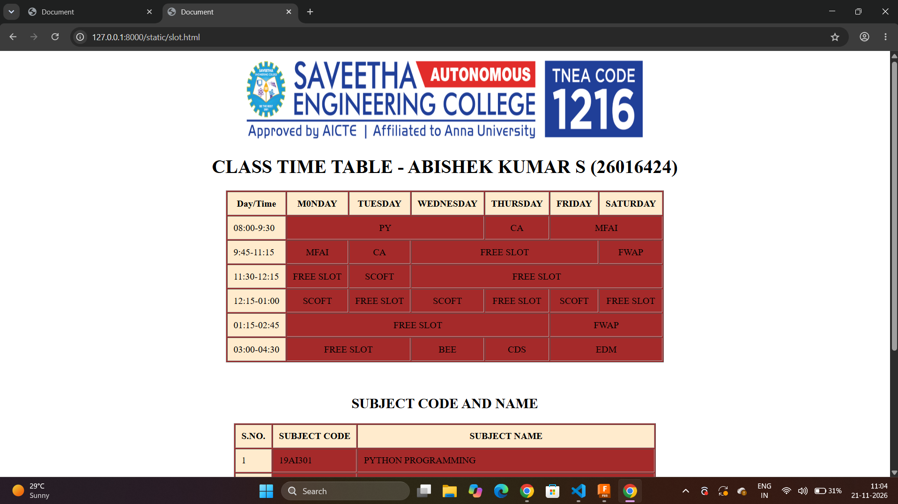

# Ex02 Time Table
## Date:21-11-2026

## AIM
To write a html webpage page to display your slot timetable.

## ALGORITHM
### STEP 1
Create a Django-admin Interface.

### STEP 2
Create an App inside the Django project.

### STEP 2
Create a static folder uder the created App and insert HTML code.

### STEP 3
Create a simple table using ```<table>``` tag in html with the relevant attributes.

### STEP 4
Add rows using ```<tr>``` tag.

### STEP 5
Add your course schedule using ```<td>``` tag.

### STEP 6
Execute the program using runserver command.

## PROGRAM
```
<html>
<head>
    <title>Document</title>
</head>
<body>
    <center>
        
        
        <h1>CLASS TIME TABLE - ABISHEK KUMAR S (26016424)</h1>
        <table border="1" cellpadding="10" style="background-color: brown;">
            <tr style="background-color: blanchedalmond;">
                <th>Day/Time</th>
                <th>M0NDAY</th>
                <th>TUESDAY</th>
                <th>WEDNESDAY</th>
                <th>THURSDAY</th>
                <th>FRIDAY</th>
                <th>SATURDAY</th>
            </tr>
            <tr>
                <td style="background-color: blanchedalmond;">08:00-9:30</td>
                <td colspan="3" style="text-align: center;">PY</td>
                <td style="text-align: center;">CA</td>
                <td  colspan="2" style="text-align: center;">MFAI</td>
                
            </tr>
            <tr>
                <td  style="background-color: blanchedalmond;">9:45-11:15</td>
                <td style="text-align: center;">MFAI</td>
                <td style="text-align: center;">CA</td>
                <td colspan="3" style="text-align: center;">FREE SLOT</td>
                <td style="text-align: center;">FWAP</td>
            </tr>
            <tr>
                <td  style="background-color: blanchedalmond;">11:30-12:15</td>
                <td style="text-align: center;">FREE SLOT</td>
                <td style="text-align: center;">SCOFT </td>
                <td colspan="4" style="text-align: center;">FREE SLOT</td>
              
              
            </tr>
            <tr>
                <td  style="background-color: blanchedalmond;">12:15-01:00</td>
                <td style="text-align: center;">SCOFT </td>
                <td style="text-align: center;">FREE SLOT</td>
                <td style="text-align: center;">SCOFT </td>       
                <td style="text-align: center;">FREE SLOT</td>
                <td style="text-align: center;">SCOFT </td>   
                <td style="text-align: center;">FREE SLOT</td>
            </tr>
            <tr>
                <td  style="background-color: blanchedalmond;">01:15-02:45</td>
                <td colspan="4" style="text-align: center;">FREE SLOT</td>
              
                <td colspan="2" style="text-align: center;">FWAP</td>
            
            
            </tr>
            <tr>
                <td  style="background-color: blanchedalmond;">03:00-04:30</td>
                <td colspan="2" style="text-align: center;">FREE SLOT</td>
                <td style="text-align: center;">BEE</td>
                <td style="text-align: center;">CDS</td>
                <td colspan="2" style="text-align: center;">EDM</td>   
             
            </tr>
        </table>
           
           
           
           
            <br>
            <br>


        <h2>SUBJECT CODE AND NAME</h2>
        <table border="1" cellpadding="10"  style="background-color: brown;">
           <tr>
                <th style="background-color: blanchedalmond;">S.NO.</th>
                <th style="background-color: blanchedalmond;"> SUBJECT CODE</th>
                <th style="background-color: blanchedalmond;">SUBJECT NAME</th>

            </tr>
            <tr> 
                <td style="background-color: blanchedalmond;">1</td>
                <td>19AI301</td>
                <td>PYTHON PROGRAMMING</td>
            </tr>
            <tr>
                <td style="background-color: blanchedalmond;">2</td>
                <td>19MA220</td>
                <td>MATHEMATICS FOR ARTIFICIAL INTELLIGENCE</td>
            </tr>
            <tr>
                <td style="background-color: blanchedalmond;">3</td>
                <td>ECA</td>
                <td>SCOFT-M-SCOFT MENTOR MEET</td>
            </tr>
            <tr>
                <td style="background-color: blanchedalmond;">4</td>
                <td>19CS305</td>
                <td>COMPUTER ARCHITECTURE</td>
            </tr>
            <tr>
                <td style="background-color: blanchedalmond;">5</td>
                <td>19EE305</td>
                <td>ELECTRICAL ELECTRONICS AND MEASUREMENT ENGINEERING</td>
            </tr>
            <tr>
                <td style="background-color: blanchedalmond;">6</td>
                <td>19EY708</td>
                <td>CAREER DEVELOPMENT SKILL</td>
            </tr>
            <tr>
                <td  style="background-color: blanchedalmond;">7</td>
                <td>19AI414</td>
                <td>FUNDAMETALS OF WEB APPLICATION DEVELOPMENT</td>
            </tr>
            <tr>
                <td style="background-color: blanchedalmond;">8</td>
                <td>19AI302</td>
                <td>ENGINEERING DESIGN AND MODELLING</td>
            </tr>
            
           
        </table>
    </center>
</body>
</html>
```


## OUTPUT



## RESULT
The program for creating slot timetable using basic HTML tags is executed successfully.
